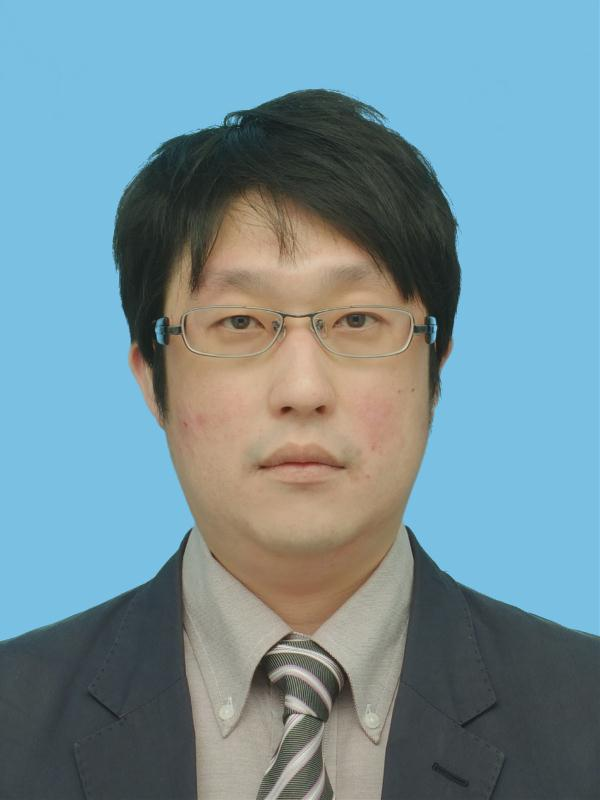
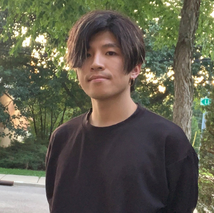

# Members

## Faculty & Staff

### [Takuma Shiga](/members/about-shiga/)
(Associate Professor · PI)

  <a href="mailto:shiga@toyota-ti.ac.jp" title="Email">Email</a>
  | 
  <a href="https://scholar.google.com/citations?user=7pXWD3kAAAAJ&hl=en"
     target="_blank" rel="noopener noreferrer">Google Scholar</a>
  |
  <a href=''>Profile</a>

### [Ryohei Nagahiro](https://researchmap.jp/ryohei-nagahiro)
(Assistant Professor)

  <a href="mailto:nagahiro@toyota-ti.ac.jp" title="Email">Email</a>
  | 
  <a href="https://scholar.google.com/citations?user=d8n0PsUAAAAJ&hl=en"
     target="_blank" rel="noopener noreferrer">Google Scholar</a>
  |
  <a href='https://ryohei-nagahiro.github.io/' target="_blank" rel="noopener noreferrer">Website</a>

### [Amey Gokhale](https://www.linkedin.com/in/amey2618)
(Post doctoral researcher)

  <a href="mailto:amey@toyota-ti.ac.jp" title="Email">Email</a>
  | 
  <a href="https://www.google.com/url?q=https://scholar.google.com/citations?user%3DsH114mcAAAAJ%26hl%3Den%26oi%3Dao&source=gmail-imap&ust=1779786656000000&usg=AOvVaw2KrP3PBUF3j52ooUnULYG5"
     target="_blank" rel="noopener noreferrer">Google Scholar</a>
  |
  <a href='https://www.google.com/url?q=https://sites.google.com/view/amey-gokhale/home&source=gmail-imap&ust=1779786656000000&usg=AOvVaw1lMpyYV_pttr3b6iBtg00W' target="_blank" rel="noopener noreferrer">Website</a>

## Graduate Students

<!-- To be added -->

## Undergraduate Students

<!-- To be added -->

### Yudai Hirakawa
（B4）

Thermal characterization of two-dimensional materials using the 3ω method

### Takumi Hirose
（B4）

Phonon thermal transport analysis of encapsulated carbon nanotubes

### Ryo Miyagawa
（B4）

Thermal characterization of thin-film materials using the thermoreflectance method

## Visiting Researchers and Students

<table class="visitor-table">
  <thead>
    <tr>
      <th scope="col">Period</th>
      <th scope="col">Name</th>
      <th scope="col">Affiliation / Status</th>
    </tr>
  </thead>
  <tbody>
    <tr>
      <td class="visitor-period">Sep. 01, 2026 – Oct. 01, 2026</td>
      <td class="visitor-name">Tài Sơn Nguyễn</td>
      <td class="visitor-affiliation">Undergraduate Student, University of Science, Vietnam National University - Ho Chi Minh city, Short-term study abroad program</td>
    </tr>
    <tr>
      <td class="visitor-period">Aug. 18, 2026 – Oct. 02, 2026</td>
      <td class="visitor-name">Corinna Shloderer</td>
      <td class="visitor-affiliation">Graduate course Student, Hochschule München, IAESTE internship program</td>
    </tr>
    <tr>
      <td class="visitor-period">May 25, 2026 – July 31, 2026</td>
      <td class="visitor-name">Jianyu Xiong</td>
      <td class="visitor-affiliation">Undergraduate Student, The Hong Kong Polytechnic University, Internship program</td>
    </tr>
    <tr>
      <td class="visitor-period">Apr. 13, 2026 – Apr. 17, 2026</td>
      <td class="visitor-name">Takashi Yoshizaki</td>
      <td class="visitor-affiliation">Graduate Student, <a href="http://www.adv.ee.es.osaka-u.ac.jp/en/">Nakamura Lab., Osaka University</a></td>
    </tr>
    <tr>
      <td class="visitor-period">Apr. 01, 2026 – Mar. 31, 2027</td>
      <td class="visitor-name">Kenichi Yatsugi</td>
      <td class="visitor-affiliation"><a href="https://researchmap.jp/kenichi-yatsugi">Toyota Central R&amp;D Labs., Inc.</a></td>
    </tr>
    <tr>
      <td class="visitor-period">Apr. 01, 2026 – Mar. 31, 2027</td>
      <td class="visitor-name">Keita Funayama</td>
      <td class="visitor-affiliation"><a href="https://researchmap.jp/page-to-keita-funaya">Toyota Central R&amp;D Labs., Inc.</a></td>
    </tr>
    <tr>
      <td class="visitor-period">Nov. 12, 2025 – Nov. 21, 2025</td>
      <td class="visitor-name">Yuki Mori</td>
      <td class="visitor-affiliation">Graduate Student, <a href="https://web.tuat.ac.jp/~htlab/">Hori Lab., Tokyo University of Agriculture and Technology</a></td>
    </tr>
  </tbody>
</table>

<!--
--!>
