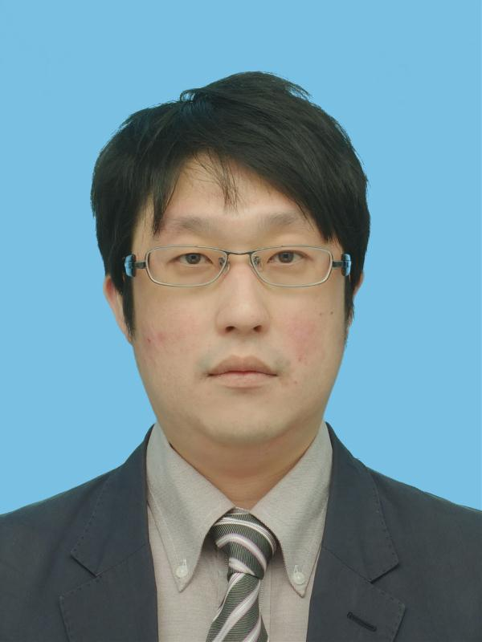

# メンバー

## 教職員・スタッフ

### [志賀 拓麿](https://researchmap.jp/takumashiga){target="_blank"}
（准教授・PI）

  <a href="mailto:shiga@toyota-ti.ac.jp" title="Email">Email</a> 
  |
  <a href="https://scholar.google.com/citations?user=7pXWD3kAAAAJ&hl=ja"
     target="_blank" rel="noopener noreferrer">Google Scholar</a>
  |
  <a href=''>個人ページ</a>

### [永廣 怜平](https://researchmap.jp/ryohei-nagahiro){target="_blank"}
（助教）

  <a href="mailto:nagahiro@toyota-ti.ac.jp" title="Email">Email</a> 
  |
  <a href="https://scholar.google.com/citations?user=d8n0PsUAAAAJ&hl=en"
     target="_blank" rel="noopener noreferrer">Google Scholar</a>
  |
  <a href='https://ryohei-nagahiro.github.io/' target="_blank" rel="noopener noreferrer">個人ページ</a>

### [Amey Gokhale](https://www.linkedin.com/in/amey2618){target="_blank"}
（ポストドクトラル研究員）

  <a href="mailto:amey@toyota-ti.ac.jp" title="Email">Email</a> 
  |
  <a href='https://www.google.com/url?q=https://sites.google.com/view/amey-gokhale/home&source=gmail-imap&ust=1779786656000000&usg=AOvVaw1lMpyYV_pttr3b6iBtg00W' target="_blank" rel="noopener noreferrer">個人ページ</a>

## 大学院生

<!-- 後で追加 -->

## 学部学生

### 平川 雄大
（B4）

3ω法を用いた二次元材料の熱物性測定

### 廣瀬 巧実
（B4）

内包カーボンナノチューブの熱輸送解析

### 宮川 凌
（B4）

サーモリフレクタンス法を用いた薄膜材料の熱物性計測

## 訪問研究者・学生

<table class="visitor-table">
  <thead>
    <tr>
      <th scope="col">滞在期間</th>
      <th scope="col">氏名</th>
      <th scope="col">所属・身分</th>
    </tr>
  </thead>
  <tbody>
    <tr>
      <td class="visitor-period">2026.09.01 – 2026.10.01</td>
      <td class="visitor-name">Tài Sơn Nguyễn</td>
      <td class="visitor-affiliation">学部学生、ホーチミン科学大学、短期留学制度</td>
    </tr>
    <tr>
      <td class="visitor-period">2026.08.18 – 2026.10.02</td>
      <td class="visitor-name">Corinna Shloderer</td>
      <td class="visitor-affiliation">修士学生、ミュンヘン応用大学、IAESTE制度</td>
    </tr>
    <tr>
      <td class="visitor-period">2026.05.25 – 2026.07.31</td>
      <td class="visitor-name">熊健余</td>
      <td class="visitor-affiliation">学部学生、香港理工大学、インターン実習制度</td>
    </tr>
    <tr>
      <td class="visitor-period">2026.04.13 – 2026.04.17</td>
      <td class="visitor-name">吉崎 高士</td>
      <td class="visitor-affiliation">博士課程学生、<a href="http://www.adv.ee.es.osaka-u.ac.jp/">大阪大学・中村研究室</a></td>
    </tr>
    <tr>
      <td class="visitor-period">2026.04.01 – 2027.03.31</td>
      <td class="visitor-name">矢次 健一</td>
      <td class="visitor-affiliation"><a href="https://researchmap.jp/kenichi-yatsugi">株式会社豊田中央研究所</a></td>
    </tr>
    <tr>
      <td class="visitor-period">2026.04.01 – 2027.03.31</td>
      <td class="visitor-name">舟山 啓太</td>
      <td class="visitor-affiliation"><a href="https://researchmap.jp/page-to-keita-funaya">株式会社豊田中央研究所</a></td>
    </tr>
    <tr>
      <td class="visitor-period">2025.11.12 – 2025.11.21</td>
      <td class="visitor-name">森 勇輝</td>
      <td class="visitor-affiliation">修士課程学生、<a href="https://web.tuat.ac.jp/~htlab/">東京農工大学・堀研究室</a></td>
    </tr>
  </tbody>
</table>

